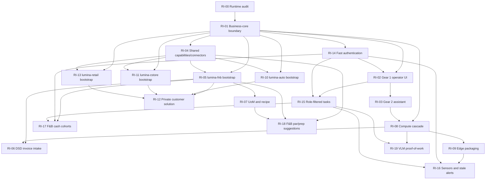

# Runtime Implementation Program

## Purpose

Track the code and integration work that follows the contract-first slices. The 73-81 slice series defines boundaries and contracts; it does not, by itself, deliver the working product. Runtime work is assigned to the repository that owns the behavior.

## Delivery Rule

Implement a runtime workstream after its directly required contract bundle is accepted. Do not wait for unrelated vertical contracts to finish, and do not start a runtime change without a linked slice/PR scope, executable acceptance criteria, tests, and an owning repository.

## Shared Roadmap Memory

This program and [SMB Operations Product Direction](smb-operations-product-direction.md) are the model-independent source of truth for product scope, repository ownership, dependency order, status, and deferred decisions. Update them through reviewed PRs when a decision or workstream changes; chat history and model-generated slice numbering are not authoritative state.

## Workstream Ledger

| ID | Runtime outcome | Owning repository | Contract prerequisites | Status |
|---|---|---|---|---|
| RI-00 | Inventory current runtime behavior and identify implemented, partial, missing, and conflicting surfaces before estimating work | `lumina-biz` | Slices 73-81 review | Completed |
| RI-01 | Establish the business-core package/release boundary and remove or relocate only vertical-specific behavior; preserve shared business capabilities | `lumina-biz` | 73, 76 | In progress |
| RI-02 | Deliver Gear 1 deterministic operator screens, permission-aware commands, and screen-context handling | `lumina-biz` | 74, RI-01, RI-14 | Planned |
| RI-03 | Deliver Gear 2 assistant drawer, screen context lock, staged drafts, human approval, and privacy-safe telemetry | `lumina-biz` | 75, RI-02, RI-14 | Planned |
| RI-04 | Implement provider-neutral POS and back-office capability interfaces, adapters, and conformance tests | `lumina-biz` | 76, RI-01 | Planned |
| RI-05 | Bootstrap `lumina-fnb` from a tagged business-core release with independent CI and core compatibility tests | `lumina-fnb` | F&B repository charter, RI-01, RI-04 | Planned |
| RI-06 | Implement local-first DSD invoice intake, extraction review, deposit/CRV and credit flags, and staged receiving handoff | `lumina-fnb` | Invoice intake contract, RI-05, RI-08 | Planned |
| RI-07 | Implement deterministic unit conversion and reviewed recipe/yield-to-BOM drafts | `lumina-fnb` | Recipe and unit contract, RI-05 | Planned |
| RI-08 | Implement the four-stage compute cascade with deterministic ordering, bounded model calls, and degraded-mode evidence | `lumina-biz` plus vertical configuration | 80, RI-01 | Planned |
| RI-09 | Deliver local-first edge packaging, offline/degraded operation, and upgrade/rollback behavior | `lumina-biz` plus vertical deployment | 81, RI-08 | Planned |
| RI-10 | Bootstrap `lumina-auto` from a tagged business-core release and port only auto-care, repair, and towing modules and tests | `lumina-auto` | Auto vertical charter, RI-01 | Planned |
| RI-11 | Bootstrap `lumina-cstore` from a tagged business-core release and port only convenience-store and fuel modules and tests | `lumina-cstore` | C-store vertical charter, RI-01 | Planned |
| RI-12 | Establish private customer solution repos from supported vertical releases, with configuration, deployment, upgrade, and acceptance gates | Customer private repo(s) | Vertical release; topology contract | Planned |
| RI-13 | Bootstrap `lumina-retail` from a tagged business-core release and port standard dry-retail workflows and tests | `lumina-retail` | Retail vertical charter, RI-01 | Planned |
| RI-14 | Implement revocable PIN, signed QR, and supported-device NFC employee authentication; BLE may preselect identity but never authenticate | `lumina-biz` | RI-01, identity/fast-auth acceptance policy | Planned |
| RI-15 | Deliver role-filtered operational tasks with accessible completion controls and auditable status transitions | `lumina-biz` | RI-01, RI-02, RI-14 | Planned |
| RI-16 | Implement authenticated sensor ingestion, buffered BLE gateway delivery, stale-reading state, and role-scoped notifications | `lumina-biz` plus vertical sensor profiles | RI-09, RI-14, RI-15 | Planned |
| RI-17 | Implement F&B till cohorts, deterministic tip-pool readiness, safe thresholds, and reviewed payout routing | `lumina-fnb` | RI-05, RI-14, RI-15 | Planned |
| RI-18 | Implement F&B par and daypart prep suggestions using historical systems-of-record data plus timestamped calendar/weather evidence | `lumina-fnb` | RI-04, RI-05, RI-07 | Planned |
| RI-19 | Implement consented proof-of-work image capture and bounded VLM review with confidence, evidence, retention, and human escalation | `lumina-biz` plus vertical policy | RI-08, RI-15 | Planned |

RI-00 is an audit, not a rewrite. The source-level baseline below records what exists in the `lumina-biz` checkout as of 2026-11-08; re-check the relevant tests before implementation estimates are committed.

## Baseline Audit Snapshot

| Area | Existing runtime | Remaining gap |
|---|---|---|
| Gear 1 / deterministic UI | `src/web/app.tsx`, `src/web/src/services/uiMode.ts`, slash-command services, plugin registration, and UI tests provide mode switching and deterministic command dispatch. | Gear 1 is still chat-centric; a task-focused POS/operator workspace and its screen registry/context contract are not present as a complete runtime surface. |
| Gear 2 / assistant | The existing chat path calls the assistant flow, and decision-precedent confirmation is implemented. | No assistant side drawer, screen-scoped context lock, staged form-draft workflow, or context-lock telemetry contract was found in the frontend runtime. |
| Business connectors | ERPNext and Odoo connector modules, fixture adapters, and a provider conformance harness exist under `src/lumina/business_ops/connectors/`. | This is not yet a complete generic POS, labor, payroll, and accounting capability runtime across providers. |
| Document ingestion | `src/lumina/ingestion/extractors.py` extracts generic PDF, DOCX, Markdown, CSV, JSON, and YAML text; `interpreter.py` provides generic SLM interpretation. | No F&B invoice-specific VLM/OCR, line-item validation, deposit/CRV handling, or receiving handoff was found in first-party runtime code. |
| Recipe and units | No first-party UoM conversion, yield calculation, or recipe-to-BOM implementation was found in `src/lumina` or `model-packs/business-ops`. | The deterministic conversion, provenance, review, and draft-write path remain to be implemented in `lumina-fnb`. |
| Compute cascade | spaCy/regex processing, glossary and vector routing, SLM calls, an LLM path, and degraded-reason tracking exist across `src/lumina/core/` and `src/lumina/api/processing.py`. | The components need an integrated, tested four-stage cascade with explicit transition, evidence, and degraded-mode acceptance; avoid replacing existing stages wholesale. |
| Edge deployment | A single-box health-check script, local-first SLM defaults, and single-box deployment documentation exist. | No complete edge-node lifecycle, offline recovery, versioned upgrade, or rollback runtime was found. |
| Repository separation | The `business-ops` pack contains an `auto-repair` module. | No separate `lumina-fnb`, `lumina-cstore`, `lumina-retail`, or `lumina-auto` checkout is present in this workspace; vertical and customer solution repos are not yet established here. |

This snapshot is an inventory, not proof that each existing surface meets its contract. RI-02 through RI-09 must add behavior-level tests around the existing partial implementations rather than duplicate them.

## RI-01 Progress

- The Python distribution metadata now identifies the artifact as `lumina-biz` rather than `project-lumina`; Python imports remain under the existing `lumina` namespace.
- A built wheel and the editable development extra were checked against this identity.
- Auto-repair workflow routes and their request/response models now live in `lumina.business_ops.auto_repair_workflow`; the generic API server mounts that router, and the previous API route import remains a compatibility shim.
- The workflow endpoint paths and authorization/draft behavior were preserved; focused workflow tests pass (6 passed), and the backend suite passes (5,056 passed, 1 skipped, 85.23% coverage).
- This is only the release-identity step. The wheel still packages the current `src/lumina` tree; generic-engine/package separation is not complete.
- The auto-repair module and workflow remain in the `lumina-biz` distribution until `lumina-auto` is bootstrapped and runtime, fixtures, and tests can be migrated together. This move changed code ownership within the package, not repository ownership. Do not remove shared connector or routing code during that move.

## Dependency Order

- RI-00 precedes scope commitment for every implementation workstream.
- RI-01 precedes all shared UI, authentication, connector, and vertical bootstrap work.
- RI-14 can proceed after RI-01; RI-02 depends on identity hooks, and RI-03 follows both the deterministic surface and authentication boundary.
- RI-04 and RI-14 can proceed in parallel after RI-01. RI-05, RI-10, RI-11, and RI-13 each require RI-01 and the shared capability boundary; no vertical blocks another.
- RI-06 requires the F&B repo and compute cascade. RI-07 can proceed independently after the F&B repo is bootstrapped; both preserve human review before mutations.
- RI-15 requires the shared UI and authentication foundations. RI-16 additionally requires edge packaging; stale alerts route through role-authorized tasks.
- RI-17 requires the F&B vertical, identity, and task primitives. It must not move or redirect wages/tips without approved jurisdictional policy and human review.
- RI-18 requires F&B capabilities, the F&B repo, and unit/recipe semantics; forecasts remain advisory evidence.
- RI-19 requires the bounded compute cascade and task/evidence surface; VLM output is advisory, never sole proof.
- RI-08 is bounded by the compute-cascade contract; RI-09 follows it and includes failure/recovery tests.
- RI-12 begins after any one supported public vertical release and customer-specific configuration boundaries are defined.

## Active Runtime Dependency DAG

All ERP transport and mutation edges remain subject to the Slice 41 gate. The graph is capability-based rather than a single serial queue: independent public verticals can proceed after their shared-core prerequisites, and private customer work begins from a supported vertical release.

## Per-Workstream Gates

Every runtime PR must:

- target the owning repository shown above;
- link the relevant contract slice and state explicit out-of-scope behavior;
- include unit and integration tests for the changed behavior, plus vertical conformance tests where applicable;
- pass repository verification and manifest integrity checks;
- preserve systems-of-record authority and human approval for mutations;
- respect Slice 41's hard gate for any ERP execution, live transport, or mutation path until its closure criteria are satisfied;
- keep customer data and secrets out of source control; and
- document release compatibility and downstream upgrade impact.

## Product Direction and Contract Documents

The authoritative capability brief is [SMB Operations Product Direction](smb-operations-product-direction.md). Numbered slice files are supporting planning artifacts, not the source of product names or vertical priority. Reconcile them to the product brief as they are revised; do not infer implementation completion from a documentation slice being merged.

Related product documents may be reviewed in one roadmap-alignment PR or a few capability-oriented PRs, provided each included contract and its acceptance evidence are listed. Runtime implementation is released separately in code PRs using RI-00 through RI-13; documentation merge does not count as runtime delivery.
