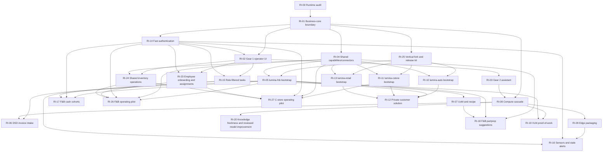

# Runtime Implementation Program

## Purpose

Track the code and integration work that follows the contract-first slices. The 73-81 slice series defines boundaries and contracts; it does not, by itself, deliver the working product. Runtime work is assigned to the repository that owns the behavior.

## Delivery Rule

Implement a runtime workstream after its directly required contract bundle is accepted. Do not wait for unrelated vertical contracts to finish, and do not start a runtime change without a linked slice/PR scope, executable acceptance criteria, tests, and an owning repository.

## Shared Roadmap Memory

This program and [SMB Operations Product Direction](smb-operations-product-direction.md) are the model-independent source of truth for product scope, repository ownership, dependency order, status, and deferred decisions. Update them through reviewed PRs when a decision or workstream changes; chat history and model-generated slice numbering are not authoritative state.

## Workstream Ledger

| ID | Runtime outcome | Owning repository | Contract prerequisites | Status |
|---|---|---|---|---|
| RI-00 | Inventory current runtime behavior and identify implemented, partial, missing, and conflicting surfaces before estimating work | `lumina-biz` | Slices 73-81 review | Completed |
| RI-01 | Establish the business-core package/release boundary and remove or relocate only vertical-specific behavior; preserve shared business capabilities | `lumina-biz` | 73, 76 | In progress |
| RI-02 | Deliver the shared employee-facing app shell and Gear 1 deterministic operator screens, permission-aware commands, app switching, persisted work, and screen-context handling | `lumina-biz` | Slice 74, RI-01, RI-14 | Planned |
| RI-03 | Deliver Gear 2 assistant drawer, screen context lock, staged drafts, human approval, and privacy-safe telemetry | `lumina-biz` | 75, RI-02, RI-14 | Planned |
| RI-04 | Implement provider-neutral POS and back-office capability interfaces, adapters, and conformance tests | `lumina-biz` | 76, RI-01 | In progress |
| RI-05 | Bootstrap `lumina-fnb` from a supported tagged business-core release with independent CI and core compatibility tests | `lumina-fnb` | Slice 77, RI-01, RI-04, RI-25 | Planned |
| RI-06 | Implement local-first DSD invoice intake, extraction review, deposit/CRV and credit flags, and staged receiving handoff | `lumina-fnb` | Invoice intake contract, RI-05, RI-08 | Planned |
| RI-07 | Implement deterministic unit conversion and reviewed recipe/yield-to-BOM drafts | `lumina-fnb` | Recipe and unit contract, RI-05 | Planned |
| RI-08 | Implement workflow- and modality-aware model selection and the four-stage compute cascade across text, vision, and audio capabilities, with bounded escalation, versioned evidence, and safe degraded modes; expose optional configured local/OpenAI-compatible providers without making inference an operations dependency | `lumina-biz` plus vertical configuration | 80, RI-01 | Planned |
| RI-09 | Deliver local-first edge packaging, offline/degraded operation, and upgrade/rollback behavior | `lumina-biz` plus vertical deployment | 81, RI-08 | Planned |
| RI-10 | Bootstrap `lumina-auto` from a supported tagged business-core release and port only auto-care, repair, and towing modules and tests | `lumina-auto` | Auto vertical charter, RI-01, RI-25 | Planned |
| RI-11 | Bootstrap `lumina-cstore` from a supported tagged business-core release and port only convenience-store and fuel modules and tests | `lumina-cstore` | C-store vertical charter, RI-01, RI-25 | Planned |
| RI-12 | Establish private customer solution repos from supported vertical releases, with configuration, deployment, upgrade, and acceptance gates | Customer private repo(s) | Vertical release; topology contract | Planned |
| RI-13 | Bootstrap `lumina-retail` from a supported tagged business-core release and port standard dry-retail workflows and tests | `lumina-retail` | Retail vertical charter, RI-01, RI-25 | Planned |
| RI-14 | Implement revocable PIN, signed QR, and supported-device NFC employee authentication; BLE may preselect identity but never authenticate | `lumina-biz` | RI-01, identity/fast-auth acceptance policy | Planned |
| RI-15 | Deliver role-filtered operational tasks with accessible completion controls and auditable status transitions | `lumina-biz` | RI-01, RI-02, RI-14 | Planned |
| RI-16 | Implement authenticated sensor ingestion, buffered BLE gateway delivery, stale-reading state, and role-scoped notifications | `lumina-biz` plus vertical sensor profiles | RI-09, RI-14, RI-15 | Planned |
| RI-17 | Implement F&B till cohorts, deterministic tip-pool readiness, safe thresholds, and reviewed payout routing | `lumina-fnb` | RI-05, RI-14, RI-15 | Planned |
| RI-18 | Implement deterministic F&B trends, seasonal/daypart velocity, par and reorder calculations using systems-of-record data; reserve AI for unresolved ambiguity or requested qualitative synthesis | `lumina-fnb` | RI-04, RI-05, RI-07 | Planned |
| RI-19 | Implement consented proof-of-work image capture and bounded VLM review with confidence, evidence, retention, and human escalation | `lumina-biz` plus vertical policy | RI-08, RI-15 | Planned |
| RI-20 | Deliver freshness-aware knowledge refresh and a reviewed, privacy-limited outcome corpus for offline model evaluation and controlled improvement | `lumina-biz` plus vertical-approved data policy | 55, 80, RI-08 | Planned |
| RI-21 | Implement the provider-neutral live SoR actor-liveness adapter boundary, bounded timeout handling, deny taxonomy, and pseudonymous evidence | `lumina-biz` | Slice 42, Slice 40 N1-N3 closure; Slice 43 for shared live transport | In progress |
| RI-22 | Implement provider-agnostic outbound connector transport with bounded timeouts, query-only retries, correlation/idempotency metadata, and canonical errors | `lumina-biz` | Slice 43, RI-04 | Completed |
| RI-23 | Deliver manager-led employee onboarding and location/register assignment in the operational app shell using Frappe users, roles, and ERPNext records; email invitation is optional | `lumina-biz` | Slice 74, RI-01, RI-02, RI-14 | Planned |
| RI-24 | Deliver shared ERPNext-backed inventory operations: barcode-first receiving and counts, optional stock locations, discrepancy review, and auditable stock-document handoff without a shadow quantity ledger | `lumina-biz` | Slice 76, RI-01, RI-04 | In progress |
| RI-25 | Establish the vertical fork/release kit: pinned core and ERPNext matrix, independent build/CI, shared-core conformance, migration/upgrade checks, and tagged release/downstream guide | `lumina-biz` | Slice 73, Slice 77, RI-01 | Planned |
| RI-26 | Deliver the first F&B operating pilot over shared POS, inventory, receiving, and identity foundations, including restaurant order, table, kitchen, menu/modifier, and acceptance workflows | `lumina-fnb` | RI-04, RI-05, RI-14, RI-23, RI-24; Slice 41 live-execution gate | Planned |
| RI-27 | Deliver the C-store operating pilot by configuring shared inventory/POS/task capabilities, then adding fuel and convenience workflows without copying F&B rules | `lumina-cstore` | RI-04, RI-11, RI-14, RI-23, RI-24 | Planned |

## Platform and Fork Sequence

This sequence is a planning baseline, not a claim that the capabilities are implemented. It turns the product direction and contract slices into executable, repository-owned work.

| Phase | Work | Exit gate |
|---|---|---|
| Shared operator foundation | RI-02 app shell, RI-14 authentication, RI-23 employee onboarding, and RI-24 inventory workflows. ERPNext/Frappe users, employees, items, warehouses, stock documents, and ledgers remain authoritative. | A manager can onboard and assign a cashier without a required email flow; the worker can reach only authorized apps/locations. Receiving and count discrepancies are auditable and post only through approved ERPNext documents. |
| Fork/release foundation | RI-25 defines a supported `lumina-biz` tag, app/dependency pin, clean-site build, compatibility matrix, independent CI, conformance suite, migration/upgrade test, and downstream change policy. | A fresh vertical checkout installs from its own manifest and passes CI against the pinned core/Frappe/ERPNext matrix without source-tree coupling, customer data, or secrets. |
| F&B first | Complete RI-05 bootstrap, then RI-26 restaurant acceptance pilot. Evaluate Lumen Restaurants and URY as replaceable candidate implementations; reuse ideas and adapters only after version, license, permissions, accounting, stock, recovery, and workflow checks. | A selected restaurant scenario passes table/order-to-kitchen-to-payment-to-close, item/ingredient stock accounting, authorized roles, retry/recovery, and offline-boundary tests on a pinned stack. No vendor UI is assumed to be the Lumina shell. |
| C-store second | Complete RI-11 bootstrap, then RI-27. Reuse shared receiving, counts, inspections, forecasting, and restaurant-compatible food workflows only where operational meanings match; fuel, tank, dispenser, and forecourt rules stay C-store-owned. | A C-store acceptance suite passes inventory, convenience POS, and fuel-specific workflows without F&B rule leakage or duplicate shared capabilities. |
| Other verticals | RI-10 and RI-13 follow the same RI-25 gate after their own charter and acceptance scenarios are approved. | Independent install, compatibility, conformance, upgrade, and domain acceptance gates pass for each vertical. |

### Vertical Fork Minimum Contents

Every public vertical fork starts from a supported `lumina-biz` release tag and contains only its vertical app/module code, model-pack configuration, vertical schemas/fixtures, documentation, and acceptance tests. It must include its own package/bench manifest, build and CI, pinned compatibility matrix, shared-core conformance tests, clean-site installation test, migration/upgrade test, release notes, and upstream sync procedure. Shared shell, authentication, connector transport, audit, and inventory primitives stay upstream in `lumina-biz`; verticals configure or extend them through documented hooks rather than copy them. Private customer repositories begin only from tagged vertical releases and contain customer configuration/integration, never production data or secrets in public repositories.

RI-00 is an audit, not a rewrite. The source-level baseline below records what exists in the `lumina-biz` checkout as of 2026-11-08; re-check the relevant tests before implementation estimates are committed.

## Baseline Audit Snapshot

| Area | Existing runtime | Remaining gap |
|---|---|---|
| Gear 1 / deterministic UI | `src/web/app.tsx`, `src/web/src/services/uiMode.ts`, slash-command services, plugin registration, and UI tests provide mode switching and deterministic command dispatch. | Gear 1 is still chat-centric; a task-focused POS/operator workspace and its screen registry/context contract are not present as a complete runtime surface. |
| Gear 2 / assistant | The existing chat path calls the assistant flow, and decision-precedent confirmation is implemented. | No assistant side drawer, screen-scoped context lock, staged form-draft workflow, or context-lock telemetry contract was found in the frontend runtime. |
| Business connectors | ERPNext and Odoo connector modules, fixture adapters, and a provider conformance harness exist under `src/lumina/business_ops/connectors/`. | This is not yet a complete generic POS, labor, payroll, and accounting capability runtime across providers. |
| Document ingestion | `src/lumina/ingestion/extractors.py` extracts generic PDF, DOCX, Markdown, CSV, JSON, and YAML text; `interpreter.py` provides generic SLM interpretation. | No F&B invoice-specific VLM/OCR, line-item validation, deposit/CRV handling, or receiving handoff was found in first-party runtime code. |
| Recipe and units | No first-party UoM conversion, yield calculation, or recipe-to-BOM implementation was found in `src/lumina` or `model-packs/business-ops`. | The deterministic conversion, provenance, review, and draft-write path remain to be implemented in `lumina-fnb`. |
| Compute cascade | spaCy/regex processing, glossary and vector routing, a single environment-selected SLM, low/high task-weight classification, an LLM path, and degraded-reason tracking exist across `src/lumina/core/` and `src/lumina/api/processing.py`. | The components need workflow- and modality-aware model capability selection for text, vision, and audio, explicit transitions and evidence, freshness-aware knowledge, reviewed outcome curation, and modality-specific degraded-mode acceptance; avoid replacing existing stages wholesale. |
| Edge deployment | A single-box health-check script, local-first SLM defaults, and single-box deployment documentation exist. | No complete edge-node lifecycle, offline recovery, versioned upgrade, or rollback runtime was found. |
| Repository separation | The `business-ops` pack contains an `auto-repair` module. | No separate `lumina-fnb`, `lumina-cstore`, `lumina-retail`, or `lumina-auto` checkout is present in this workspace; vertical and customer solution repos are not yet established here. |

This snapshot is an inventory, not proof that each existing surface meets its contract. RI-02 through RI-09 must add behavior-level tests around the existing partial implementations rather than duplicate them.

## RI-01 Progress

- The Python distribution metadata now identifies the artifact as `lumina-biz` rather than `project-lumina`; Python imports remain under the existing `lumina` namespace.
- A built wheel and the editable development extra were checked against this identity.
- Auto-repair workflow routes and their request/response models now live in `lumina.business_ops.auto_repair_workflow`; the generic API server mounts that router, and the previous API route import remains a compatibility shim.
- Domain-owned FastAPI routers are opt-in through `adapters.api_routers`; the core server mounts only routers declared by a runtime config, and Business Ops explicitly registers Auto Repair.
- Chat thread recaps now load their optional routing policy from the resolved domain runtime; domains without a policy no longer inherit the Business Ops policy path.
- The workflow endpoint paths and authorization/draft behavior were preserved; focused workflow tests pass (6 passed), and the backend suite passes (5,056 passed, 1 skipped, 85.23% coverage).
- This is only the release-identity step. The wheel still packages the current `src/lumina` tree; generic-engine/package separation is not complete.
- The auto-repair module and workflow remain in the `lumina-biz` distribution until `lumina-auto` is bootstrapped and runtime, fixtures, and tests can be migrated together. This move changed code ownership within the package, not repository ownership. Do not remove shared connector or routing code during that move.

## RI-04 Progress

- The connector execution API's Pydantic action and capability literals now match the canonical request schema, including POS, purchasing, timekeeping, accounting, and all six canonical action classes.
- Connector registry entries can preserve per-namespace supported actions; exact declarations are authoritative in routing, preventing flattened summary lists from claiming undeclared combinations.
- Provider-specific connector mappings remain narrower by design; unimplemented namespace/action pairs pass envelope validation and return structured unsupported results rather than being rejected as non-canonical input.
- ERPNext now declares and maps read-only `sales/pos` queries to its POS Invoice sub-ledger; the shared manifest-driven fixture harness verifies every declared provider capability/action pair.
- Focused ERPNext connector, conformance, and routing tests pass (31 passed). Full backend suite passes (5,183 passed, 1 skipped) at 85.48% coverage.
- This adds a fixture-backed mapping, not live transport or checkout/session-close mutations. Those remain separate RI-04 work and subject to the Slice 41 gate and existing approval controls.

## RI-21 Progress

- The protected-context hook consumes a structured `ActorLivenessResult` with strict boolean `allow`, deterministic `deny_reason`, and a format-restricted non-PII `evidence_code`; malformed outputs and unavailable/timeouts remain distinct deny-closed outcomes with pseudonymous observations. The liveness matrix passes (11 tests).
- `ERPNextActorLivenessAdapter` performs a read-only Frappe `User.enabled` check through RI-22 transport, requesting only `name`/`enabled`, binding each instance to an expected organization/site, and using an injected authorization-header provider.
- API startup now composes the verifier only when all five `LUMINA_ERP_ACTOR_LIVENESS_*` settings are present; API key/secret values are read at verification time and the owned HTTP client is closed at shutdown. Partial configuration fails fast; absent configuration preserves the current verifier path.
- Fixture tests cover active, disabled, missing, malformed, unavailable, scope mismatch, HTTPX URL-log suppression, credential-provider failure, and public package export (12 passed); runtime composition, rotation, scope, and lifecycle tests pass (4 passed).
- A disposable ERPNext 16.60.0 Docker site verified the real `User.enabled` read through the runtime composition and a signed-bearer protected-context HTTP probe: enabled Administrator allowed, wrong site denied with HTTP 403. The temporary ERP API secret was rotated; no production SoR or customer data was used. Production identity/secret-store configuration and live-tenant acceptance remain open; no business-operation mutation is added.

## RI-24 Progress

- ERPNext inventory capability declarations now expose draft-only `create_draft` and `update_draft` operations alongside read-only `query`; `request_commit`, `request_cancel`, and live stock submission remain undeclared and unsupported.
- Inventory `query` keeps the existing Item catalog default and accepts the explicit `query_type=stock_balances` view, which maps to ERPNext `Bin` with item, warehouse, actual quantity, and stock UOM fields. Unknown or malformed query types are rejected; `Bin` remains a read-only system-of-record view, not a Lumina quantity ledger.
- `ERPNextInventoryScanAdapter` uses ERPNext's permission-checked `scan_barcode` method over the shared bounded query transport and returns canonical transport results for barcode, serial, batch, or warehouse scans. Each instance is bound to an expected organization/site and rejects malformed or mismatched caller scope before network access. It performs no stock mutation; operator UI integration and warehouse/location authorization remain open.
- Receiving drafts map to ERPNext `Stock Entry` with the required `stock_entry_type=Material Receipt`; conflicting type/purpose values are rejected and the derived read-only `purpose` field is omitted. Count creation requires a company and non-empty item rows with item code, warehouse, and non-negative quantity or valuation rate; it sets the required `Stock Reconciliation` purpose and rejects opening-stock/adjustment-entry purposes. Count drafts remain unsubmitted; updates preserve the receiving/count operation kind and target the corresponding draft document doctype.
- This establishes provider-neutral draft and discrepancy evidence without creating a local quantity ledger or submitting stock documents. Live mutation, barcode-first UI, warehouse/location assignment, discrepancy approval, and ERPNext stock-document execution remain follow-on work under the existing live-execution gate.
- Focused ERPNext mapping tests cover catalog and stock-balance query views, count/receiving draft mappings, strict numeric validation, and unsupported live inventory commits.

## RI-22 Progress

- The shared `lumina.business_ops.connectors.transport` seam supports bounded HTTPX timeouts, query-only retries, correlation IDs, explicit mutation idempotency-key propagation, and canonical transport errors without echoing provider response bodies. Redirects are disabled per request and inherited idempotency defaults are removed unless explicitly requested.
- Targeted tests cover transient query retry, mutation non-replay under redirects, GET query-parameter encoding, timeout normalization, the HTTP error matrix, malformed responses, safe metadata propagation, and policy bounds (22 passed). RI-22 is complete; provider-specific business-operation execution remains separate work.

## Dependency Order

- RI-00 precedes scope commitment for every implementation workstream.
- RI-01 precedes shared UI, authentication, connector, inventory, and fork/release work.
- RI-02 implements Slice 74 and provides the app host/state contract. RI-14 provides authentication; together they enable RI-23 employee onboarding and app availability. ERPNext/Frappe remains the user, role, employee, and transaction authority.
- RI-24 uses Slice 76 and RI-04's provider-neutral boundary. ERPNext warehouses and stock ledgers remain authoritative; optional location records describe placement/count evidence and never become a shadow quantity ledger.
- RI-25 implements the lifecycle in Slice 73 and Slice 77. It precedes RI-05, RI-10, RI-11, and RI-13; no vertical repo is considered supported until its clean install, independent CI, compatibility, conformance, migration, and upgrade checks pass.
- RI-14 can proceed after RI-01; RI-02 depends on identity hooks, and RI-03 follows both the deterministic surface and authentication boundary.
- RI-04 and RI-14 can proceed in parallel after RI-01. RI-22 provides generic transport for RI-04 adapters and RI-21; provider-specific live execution remains subject to Slice 41.
- RI-05 bootstraps the F&B repo after RI-25. RI-26 is the first F&B operating pilot and follows shared identity, shell, POS, and inventory foundations; candidate POS apps are evaluation inputs, not architecture decisions. RI-27 follows the same shared foundations after RI-11, with fuel and convenience logic owned by `lumina-cstore`.
- RI-06 requires the F&B repo and compute cascade. RI-07 can proceed independently after the F&B repo is bootstrapped; both preserve human review before mutations.
- RI-15 requires the shared UI and authentication foundations. RI-16 additionally requires edge packaging; stale alerts route through role-authorized tasks.
- RI-17 requires the F&B vertical, identity, and task primitives. It must not move or redirect wages/tips without approved jurisdictional policy and human review.
- RI-18 requires F&B capabilities, the F&B repo, and unit/recipe semantics; forecasts remain advisory evidence.
- RI-19 requires the bounded compute cascade and task/evidence surface; VLM output is advisory, never sole proof.
- RI-08 is bounded by the compute-cascade contract; RI-09 follows it and includes failure/recovery tests.
- RI-20 requires the knowledge-index lifecycle and compute-cascade evidence contracts. Knowledge refresh remains separate from training; any model improvement uses reviewed, purpose-limited examples and offline evaluation, never raw-chat training or autonomous online updates.
- RI-21 owns the Slice 42 actor-liveness runtime outcome. The Slice 42 contract is its prerequisite; any live network call must use Slice 43's generic transport, and RI-21 does not include business-operation transport or mutations.
- RI-12 begins after any one supported public vertical release and customer-specific configuration boundaries are defined.

## Active Runtime Dependency DAG

All ERP transport and mutation edges remain subject to the Slice 41 gate. The graph is capability-based rather than a single serial queue: independent public verticals can proceed after their shared-core prerequisites, and private customer work begins from a supported vertical release.

## Per-Workstream Gates

Every runtime PR must:

- target the owning repository shown above;
- link the relevant contract slice and state explicit out-of-scope behavior;
- include unit and integration tests for the changed behavior, plus vertical conformance tests where applicable;
- pass repository verification and manifest integrity checks;
- preserve systems-of-record authority and human approval for mutations;
- respect Slice 41's hard gate for any ERP execution, live transport, or mutation path until its closure criteria are satisfied;
- keep customer data and secrets out of source control;
- keep raw chat transcripts out of knowledge and training stores; model improvement must use reviewed, purpose-limited structured examples with evaluation and rollback evidence; and
- document release compatibility and downstream upgrade impact.

## Product Direction and Contract Documents

The authoritative capability brief is [SMB Operations Product Direction](smb-operations-product-direction.md). Numbered slice files are supporting planning artifacts, not the source of product names or vertical priority. Reconcile them to the product brief as they are revised; do not infer implementation completion from a documentation slice being merged.

Related product documents may be reviewed in one roadmap-alignment PR or a few capability-oriented PRs, provided each included contract and its acceptance evidence are listed. Runtime implementation is released separately in code PRs using RI-00 through RI-27; documentation merge does not count as runtime delivery.
